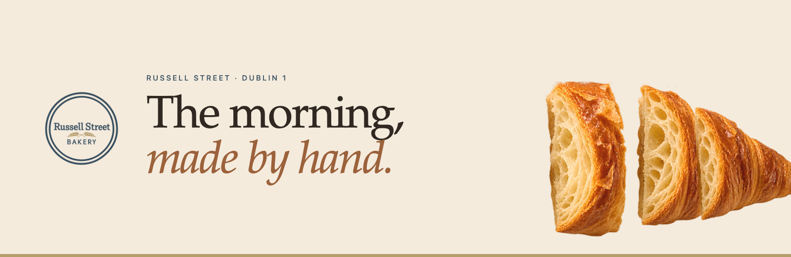
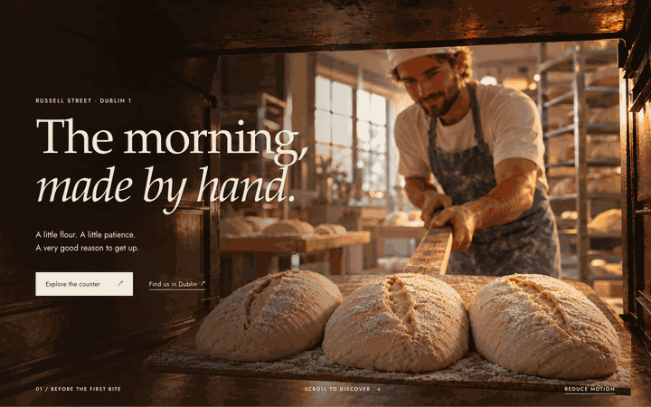
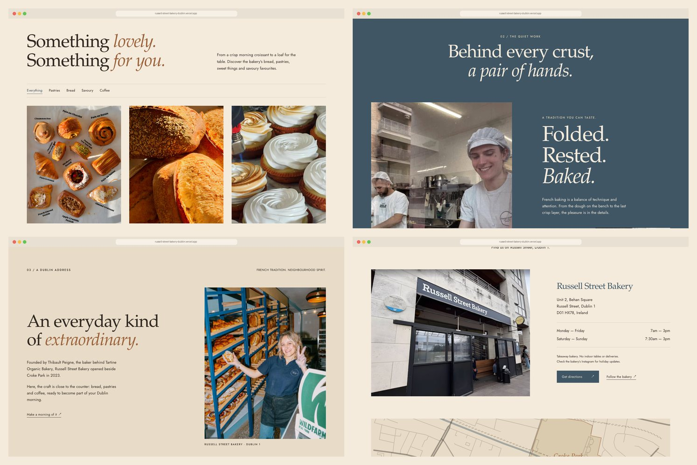
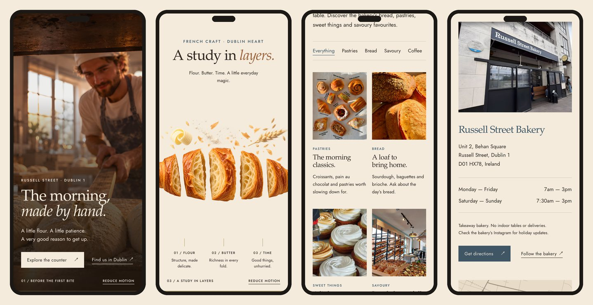
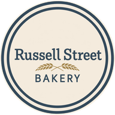

<div align="center">



<h3>A one-page website for a French bakery in Dublin 1, opening with a scroll-driven 2.5D scene seen from inside the oven.</h3>

<p>
  <a href="https://russell-street-bakery-dublin.vercel.app"><strong>🌐 Live site</strong></a>
  &nbsp;·&nbsp;
  <a href="#hero-animation"><strong>🎬 How the hero works</strong></a>
  &nbsp;·&nbsp;
  <a href="#getting-started"><strong>🛠️ Run it locally</strong></a>
</p>

<p>
  <a href="https://russell-street-bakery-dublin.vercel.app"></a>
  
  
  
  
</p>

</div>

<br />

## 🚀 Overview

**Russell Street Bakery** is a French bakery at Behan Square, beside Croke Park, founded by Thibault Peigne, the baker behind Tartine Organic Bakery. The site is built around its own line: **The morning, made by hand.** The first screen looks out from inside the oven as a baker slides a peel of three raw loaves towards you; as you scroll, the warmth of the oven turns into cream and a classic croissant opens into five sections, with flour, butter and wheat floating above.

Below the opening, the page belongs to the real bakery: the counter, the team at the bench, the bread racks, the coffee and the shopfront on Russell Street, then the address, the opening hours and a map drawn from OpenStreetMap.

- **Cinematic first impression**: a sticky 2.5D scene made of measured image layers, not a video, driven by native scroll
- **The real place**: every photo below the hero comes from the bakery itself, cropped so no Instagram interface shows
- **Honest content**: no prices, stock, delivery, ordering, tables, phone or e-mail that the bakery hasn't confirmed
- **Built for every visitor**: complete without JavaScript, a static version with reduced motion (system setting or the on-page switch), keyboard support and visible focus
- **Light**: about 600 KB on first load at 1× (16 requests), about 760 KB on a 3× phone

<br />

<a name="hero-animation"></a>

## 🎬 The hero animation

<div align="center">
  <a href="https://russell-street-bakery-dublin.vercel.app"></a>
  <sub>Scroll-scrubbed on the live site · captured at 1440 × 900</sub>
</div>

<br />

The hero stays pinned for 2.4 screen heights on desktop (2.05 on phones) and follows the kit's scroll script (`motionAt(p)`):

| Scroll  | What happens                                                                                          |
| :------ | :---------------------------------------------------------------------------------------------------- |
| 0–16%   | **Before the first bite**: the baker, the three loaves, the title and both calls to action             |
| 16–32%  | The peel advances towards the camera while the title lifts away                                       |
| 29–57%  | **The warmth between**: a soft glow rises and the oven fades                                          |
| 40–60%  | The cream scene arrives: **A study in layers.** with FLOUR, BUTTER and TIME                            |
| 60–100% | The five croissant sections drift apart; the ingredients rise a little                                |

**Under the hood**

- 🧩 **Measured layers.** The kit's peel-and-loaves PNG was recomposed by the generator, so it was registered onto the master scene with SIFT and a similarity transform (309 inliers, 1.9 px median error, scale 0.770). `scripts/measure-hero.py` writes the result to `src/data/hero.json`.
- 🪵 **Attached to the handle.** The peel grows by the kit's ratio (0.70 → 0.88) about the point where the baker's handle meets the loaves, measured on a zoomed grid, so the blade never slides off the handle painted in the background.
- 🥐 **Cut by its own shape.** The croissant is split into five sections and an ingredient cloud from the alpha channel (connected components, soft edges given to the nearest piece). The pieces recompose to the master with a mean difference of 0.08 / 255, and the only contact point, flour landing on the middle crest, is feathered.
- 🔍 **Sharper sources.** The 1536 px masters and the small Instagram crops were upscaled ×2 with Real-ESRGAN before the WebP/AVIF pipeline.
- 🐢 **Graceful by default.** Without JavaScript or with reduced motion, the opening scene is a still and the croissant scene follows it as a normal section, so nothing is hidden.

<br />

## 🖥️ Sections

<div align="center">
  
</div>

<br />

| #   | Section                                   | Anchor     | Role                                                                                     |
| :-- | :---------------------------------------- | :--------- | :--------------------------------------------------------------------------------------- |
| 01  | **The morning, made by hand.**            | `#top`     | The oven scene, then *A study in layers.*; links to the counter and to the visit details |
| 02  | Opening note                              | n/a        | Baked with care · Russell Street, Dublin 1 · Take a little goodness with you              |
| 03  | **Something lovely. Something for you.**  | `#counter` | Five families of bakes with real photos and filters; the selection is never shown as live stock |
| 04  | **Behind every crust, a pair of hands.**  | `#craft`   | The team shaping dough and croissants before the oven                                    |
| 05  | **An everyday kind of extraordinary.**    | `#story`   | Thibault Peigne, the Tartine connection and the 2023 opening beside Croke Park           |
| 06  | In good company                           | n/a        | Links to All the Food and Visit Dublin; no invented awards or reviews                    |
| 07  | **Your next good morning.**               | `#visit`   | Shopfront, address, current hours, takeaway note, directions and an OpenStreetMap map    |
| 08  | Footer                                    | n/a        | Logo, signature, Instagram and back to the top                                           |

<br />

## 📱 Mobile first, motion optional

<div align="center">
  
</div>

<br />

- The baker and the loaves stay framed on the right, the title sits low over a dark gradient
- The croissant is enlarged into a horizontal band that bleeds off both edges
- The counter keeps two columns down to 380 px; every touch target is at least 44 px
- No horizontal scroll at 320, 390 and 430 px, on tablets, low laptops or a 2560 px screen

<br />

## ✨ Highlights

- **🎞️ Scroll storytelling**: `motionAt(p)` from the kit's study, written as CSS custom properties once per animation frame, with passive listeners and cleanup
- **🧺 Filterable counter**: Everything / Pastries / Bread / Savoury / Coffee with `aria-pressed` and a polite live count; the sixth cell says the selection changes and points to Instagram
- **🗺️ A real map**: streets, the Royal Canal and Croke Park drawn from OpenStreetMap with the bakery's own node at the exact centre
- **🌗 Motion switch**: *Reduce motion* is remembered between visits and follows the system setting
- **♿ Accessible details**: skip link, Escape closes the menu and returns focus, the hidden scene is inert until it appears, focus on a faded call to action brings it back into view
- **🖼️ Image pipeline**: masters stay untouched; `npm run images` writes AVIF, WebP and JPEG in several widths with versioned names for immutable caching
- **🔎 Ready to share**: Open Graph image captured from the built hero, `Bakery` structured data with hours and coordinates, favicons

<br />

## 💻 Tech stack

| <br />Vite 6 | <br />JavaScript | <br />HTML5 | <br />CSS3 | <br />Python · OpenCV | <br />Vercel |
| :---: | :---: | :---: | :---: | :---: | :---: |

### Why this stack?

- **Vite + plain JavaScript**: the page is static HTML rendered at build time from `src/data/site.js`; the scene needs only a few hundred lines of native code, no animation library
- **Python + OpenCV + sharp**: the layers are measured and cut once, offline, so the browser only moves finished images
- **Self-hosted fonts**: P052 (URW base35) for titles and italics, Jost for the text, no third-party font requests
- **Vercel**: every push to `main` deploys automatically

<br />

## 🎨 Design system

| Token  | Value                                                                       | Use                                         |
| :----- | :-------------------------------------------------------------------------- | :------------------------------------------ |
| Cream  |  | Main background, croissant scene            |
| Linen  |  | Story, notes, map ground                    |
| Ink    |  | Text and details                            |
| Slate  |  | Logo blue, craft section, main actions      |
| Wheat  |  | Ticks, rules, progress bar (never as text)  |
| Crust  |  | Large italics and the warmth of the oven    |

- **Type**: P052 roman and italic for titles (42–144 px), Jost for text (16–18 px) and spaced capitals (11–12 px)
- **Contrast**: ink on cream 12.3:1, slate on cream 6.5:1, straw capitals on slate 5.3:1; crust only at display sizes
- **Grid**: content column up to 1680 px, side margins 20–88 px
- **Motion**: the hero follows the scroll; sections rise 28 px on entry; nothing moves with reduced motion

<br />

<a name="getting-started"></a>

## 🛠️ Getting started

```bash
# Clone the repository
git clone https://github.com/Jeanfr1/russell-street-bakerywebsite.git
cd russell-street-bakerywebsite

# Install dependencies (Node 20.10+)
npm install

# Start the dev server  →  http://localhost:5173
npm run dev

# Production build  →  dist/
npm run build

# Preview the production build  →  http://localhost:4191
npm run preview

# Browser QA on the preview (8 widths, no-JS, reduced motion, real clicks)
npm run qa
```

The image work runs offline with Python (OpenCV, PyTorch for the upscaler):

```bash
npm run hero      # register the peel, cut the croissant → src/data/hero.json
python3 scripts/upscale.py    # Real-ESRGAN ×2 (weights in ~/.cache/realesrgan)
npm run images    # AVIF / WebP / JPEG → public/img + src/data/images.json
npm run fonts     # subset P052 → public/fonts
```

<br />

## 📁 Project structure

```
russell-street-bakerywebsite/
├── index.html                  # Shell; the page is rendered into it at build time
├── vite.config.js              # Render plugin (src/render.js)
├── src/
│   ├── data/
│   │   ├── site.js             # Facts and copy (from the kit's CONTEUDO-EN and dados.json)
│   │   ├── hero.json           # Measured peel transform and croissant pieces
│   │   ├── photos.json         # Crops that hide the Instagram interface
│   │   ├── images.json         # Generated image manifest
│   │   └── map.svg             # OpenStreetMap drawing
│   ├── render.js               # Sections, <picture> markup, head and structured data
│   ├── main.js                 # Entry: fonts, styles, modules
│   ├── js/hero.js              # motionAt(p), motion switch, cleanup
│   ├── js/ui.js                # Menu, filters, reveals
│   └── styles/main.css         # Tokens, static layout, scroll scene, responsive rules
├── public/                     # img/, fonts/ (with licence), Open Graph image, favicons
├── scripts/                    # measure-hero.py, upscale.py, build-map.py, build-images.mjs, qa.mjs …
└── 01-identidade … 08-estudo/  # The design kit, kept as the source of truth (not deployed)
```

<br />

## 🚀 Deployment

Hosted on **Vercel** and connected to this repository: every push to `main` ships to production.

**Live site:** [russell-street-bakery-dublin.vercel.app](https://russell-street-bakery-dublin.vercel.app)

| Setting          | Value           |
| :--------------- | :-------------- |
| Framework        | Vite            |
| Build command    | `npm run build` |
| Output directory | `dist`          |

The site is `noindex` (meta and `X-Robots-Tag`) until the bakery approves it and a final domain is chosen.

<br />

## 📌 Content checklist

Items waiting on the bakery. Each one is marked `TODO(russell)` in `src/data/site.js`.

- [ ] Official logo master (the current PNG is a transparent derivation of the profile avatar)
- [ ] Full-resolution originals of the nine photos (the current files are screenshots)
- [ ] Bank-holiday and Christmas exceptions to the opening hours
- [ ] Google Maps place link for **Get directions** (it currently searches the bakery by name and address)
- [ ] A dated menu with prices, only if the bakery wants one; phone and e-mail stay off until confirmed
- [ ] Final domain (then update `canonical` and `og:url`, and remove `noindex`)

Brief choices made while building:

- The kit's preset peel numbers (scale 0.70 → 0.88, +8 vh) were replaced by the measured registration; the growth ratio is kept
- The kit's crop rectangles still showed Instagram icons and ran past a grid tile; the crops were redone and the pinned-post icon was inpainted
- The study's 8–12 px text was raised to 11–18 px for legibility
- The mockup shows three counter cards; the copy and study have five, so five cards plus a note card fill the grid
- With reduced motion the kit hides the croissant scene; here it stays on the page as a still section
- The story photo is shown straight, as in the mockup, not tilted as in the study

<br />

## 🙏 Acknowledgments

- **Russell Street Bakery** for the photos, the identity and the brief
- **[OpenStreetMap](https://www.openstreetmap.org/copyright)** contributors for the map data (ODbL)
- **[URW base35](https://github.com/ArtifexSoftware/urw-base35-fonts)** for P052 (AGPL-3 with font exception, licence in `public/fonts`)
- **[Jost](https://fonts.google.com/specimen/Jost)** by indestructible type* (OFL)
- **[Real-ESRGAN](https://github.com/xinntao/Real-ESRGAN)** for the upscaling model
- **[Vite](https://vite.dev)** and **[Vercel](https://vercel.com)**

<br />

---

<div align="center">
  
  <p><strong>The morning, made by hand.</strong></p>
  <p>Built with ❤️ by <a href="https://github.com/Jeanfr1">Jean</a> for Russell Street Bakery</p>
  <sub>© 2026 Russell Street Bakery. All rights reserved.</sub>
</div>
